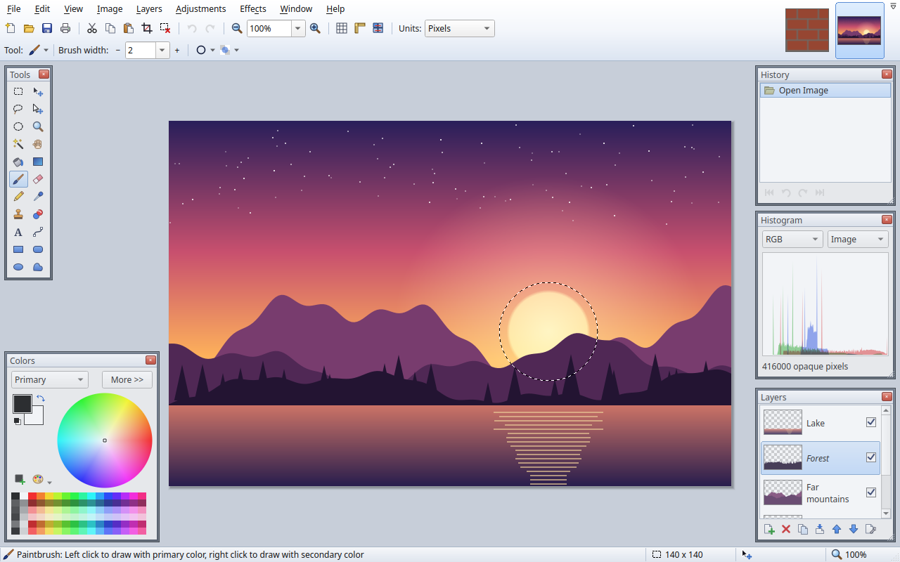

# PixelForge

A native Linux image editor (C++17 / Qt 6) that reproduces the classic
Paint.NET 3.x workflow: floating translucent tool windows, the two-row toolbar with
a context-sensitive tool options bar, image thumbnails in the top-right corner,
layers with blend modes, unlimited history, adjustments and effects with live preview.



Only the UI and behaviour are modelled. No proprietary file formats, code or artwork
are used: all icons are drawn procedurally at runtime, and layered documents are
stored as **OpenRaster (.ora)**, the open format shared with GIMP, Krita and MyPaint.

## Build

Requirements: Qt 6 (Widgets, PrintSupport), zlib, CMake ≥ 3.20, a C++17 compiler.

```sh
cmake -S . -B build -DCMAKE_BUILD_TYPE=Release
cmake --build build -j
./build/pixelforge [images...]
```

Install system-wide (binary, plugins, desktop entry): `sudo cmake --install build`.

Headless end-to-end test (drives the real tools with synthetic input, optional
screenshots):

```sh
QT_QPA_PLATFORM=offscreen ./build/pixelforge_selftest [screenshot-dir]
```

## What's in it

**Workspace** — floating Tools / Colors / History / Layers windows that go translucent
when the pointer leaves them, snap to edges, stay anchored to their corner on resize
(F5–F8 toggle, *Window → Reset Window Locations*); image thumbnail tabs with unsaved
marker, close button and dropdown list; rulers, pixel grid, units (px / in / cm);
zoom presets, *Zoom to Window*, *Zoom to Selection*, Ctrl+wheel zoom around the cursor,
Space or middle-button panning; status bar with tool hint, selection size, cursor
position and zoom.

**Tools** (shortcut letters cycle within a group; Shift cycles backwards)

| Key | Tools |
|-----|-------|
| S | Rectangle Select, Lasso Select, Ellipse Select, Magic Wand |
| M | Move Selected Pixels, Move Selection |
| Z / H | Zoom (click, right-click, drag a rectangle) / Pan |
| F / G | Paint Bucket (contiguous/global, tolerance, hatch fills) / Gradient (linear, reflected, diamond, radial, conical; color or transparency mode; editable handles) |
| B / E / P | Paintbrush / Eraser / Pencil |
| K | Color Picker (1×1…9×9 sampling, layer or image, after-pick action) |
| L / R | Clone Stamp (Ctrl+click sets source) / Recolor |
| T | Text (font, size, B/I/U/S, alignment, movable while editing) |
| O | Line/Curve (drag handles or the line to bend, Enter to finish), Rectangle, Rounded Rectangle, Ellipse, Freeform Shape |

Paintbrush, Eraser and Clone Stamp have a **Hardness** slider next to the brush width:
100% paints a hard edge, lower values fade the brush out smoothly towards its rim
(overlaps within one stroke never build up).

Selection modifiers: Ctrl = add, right button = subtract, Ctrl+right = xor,
Alt = intersect, Shift = square/circle. Move Selected Pixels: drag to move, handles to
scale (Shift keeps aspect), right-drag to rotate (Shift snaps to 15°), arrow keys nudge,
switching tools records *Finish Pixels*. Left button paints with the primary color,
right button with the secondary. Antialiasing and Normal/Overwrite blending toggles
apply to every painting tool, and painting is clipped to the selection.

**Layers** — add, delete, duplicate, merge down, move up/down, import from file,
flip, rotate/zoom, properties (name, visibility, 14 blend modes, opacity) with live
preview; click the checkbox to hide/show, double-click for properties.

**Image** — crop to selection, resize (best quality / bilinear / nearest), canvas
size with 9-way anchor, flip, rotate 90°/180°, flatten.

**Edit** — undo/redo plus clickable history list; cut, copy, copy merged, paste (as a
movable floating selection, with an offer to expand the canvas), paste into new
layer / new image; select all, deselect, invert, erase and fill selection.

**Adjustments** — Auto-Level, Black and White, Brightness/Contrast, Curves,
Hue/Saturation, Invert Colors, Levels, Posterize, Sepia.

**Effects** — Artistic (Ink Sketch, Oil Painting, Pencil Sketch), Blurs (Fragment,
Gaussian, Motion, Radial, Unfocus, Zoom), Distort (Bulge, Frosted Glass, Pixelate,
Polar Inversion, Twist), Noise (Add Noise, Median), Photo (Glow, Red Eye Removal,
Sharpen, Soften Portrait, Vignette), Render (Clouds, Julia, Mandelbrot), Stylize
(Edge Detect, Emboss, Outline, Relief). Ctrl+F repeats the last effect.

**Files** — open anything Qt can read (PNG, JPEG, BMP, GIF, TIFF, WebP, ICO, …) and
.ora; save .ora (layers, blend modes, opacity) or flattened PNG/JPEG/BMP/TIFF/WebP
with a quality dialog; drag & drop; print.

## Texture-artist features

**Tile Preview** (*View → Tile Preview*, Ctrl+Shift+T, toolbar button) — the image
is repeated in a 3×3 block around the canvas. Painting wraps: brush, eraser, pencil,
clone stamp, recolor, shapes, lines and text crossing an edge continue on the
opposite side, and you can paint directly on the neighbouring copies. Click tools
(bucket, color picker, magic wand, text) map neighbour clicks back into the canvas.

**Normal maps** (*Effects → Maps*) — *Normal Map* from height (luminance or a single
channel, strength, smoothing, invert, OpenGL Y+ / DirectX Y− output, seamless wrap),
*Height Map*, *Normalize Normal Map*, *Flip Normal Green*. *Layers → Create Normal Map
Layer...* builds a layer named `normal` from the visible image in one step.

**Animation window** (*Window → Animation*, F9) — plays the image as: a vertical strip
of stacked frames (auto-detects square frames, e.g. 16×64 → 4 frames), a horizontal
strip, one frame per layer (optionally with the bottom layer as a fixed background
and hidden layers skipped), or a texture scrolling vertically/horizontally with
wrap-around. Adjustable fps, step, pixelated scaling; updates live while you paint.

**3D Model Preview** (*Window → 3D Model Preview*, F12) — open (or drop) an OBJ (+MTL),
FBX (binary 7.x or ASCII, embedded textures included), glTF 2.0 (.gltf/.glb), STL or PLY model and see the current image mapped onto it through
the model's UVs, updating live while you paint. Every material of the model is a texture
slot with a *Color* and a *Normal* combobox: pick the whole image, any layer (hidden layers
work too), the material's own colour or texture, or *(none)*. Materials start as *(none)*,
which hides them completely (not drawn, no UVs), so only what you assign is shown. Layers
named after a material (`Body`, `body normal`, `Body_n`) and a lone `normal` layer are
assigned automatically.
Drag to orbit, right/middle-drag to pan, wheel to zoom, double-click to reset; toggles for
pixelated sampling, lighting, normal maps, two-sided faces, wireframe and auto-rotate. Drag the
handle between the 3D view and the options to give either more room.
*UVs on canvas* draws the model's UV layout over the image in the editor (like the pixel grid,
with an opacity slider): a material bound to the whole image always shows its UVs, one bound to
a layer only while that layer is the active one, so you see exactly the UVs you are painting.
Models with several UV maps (glTF `TEXCOORD_n`, FBX UV layers) get a *UV map* selector that
switches both the preview and the overlay.
The Magic Wand and Paint Bucket get a third **Flood Mode: UV Map**: click inside a UV island to
select or fill that whole island, or between islands to take the connected gap space around
them (tolerance is not used). It works on the islands of the materials whose UVs the overlay
would show: bound to the whole image, or to the active layer.
The model file is watched and reloads when it is re-exported.

Other formats are converted on open, in the background: if **assimp**, **FBX2glTF** or
**Blender** is installed, the file is turned into a binary glTF and loaded as usual (tools are
tried in that order until one succeeds; FBX files the built-in reader can't handle fall back
to them too). Blender adds `.blend`, USD (`.usd/.usda/.usdc/.usdz`), Alembic (`.abc`),
`.3ds`, X3D/VRML and DXF where its importers are available; assimp adds DAE, 3DS, X, LWO,
MS3D, MD2/MD3/MD5, OFF, 3MF, IFC and many more. Conversions are cached in
`~/.cache/pixelforge/modelview` by file path and modification time (newest 32 kept), so
reopening is instant. `PIXELFORGE_BLENDER`, `PIXELFORGE_ASSIMP` and `PIXELFORGE_FBX2GLTF`
point at tools outside `$PATH`. Software-rendered, so it needs
no GPU drivers; `-DPIXELFORGE_MODELVIEW=OFF` skips it.

## Plugins

Plugins are Qt shared libraries implementing `PixelForge::Plugin` from
[`src/pluginapi.h`](src/pluginapi.h); they need only that header and Qt. They are
loaded from `$PIXELFORGE_PLUGIN_PATH`, `<bin>/plugins`, `<prefix>/lib/pixelforge/plugins`
and `~/.local/share/pixelforge/plugins`. *Help → Plugins...* lists what was loaded.

### Example plugins (`plugins/examples`)

Built by default (`-DPIXELFORGE_EXAMPLE_PLUGINS=OFF` to skip) and meant as starting
points for your own:

| Plugin | Shows how to |
|--------|--------------|
| `hello` | add a menu action and query the host (*Help → Say Hello...*) — the minimal plugin |
| `histogram` | add a floating tool window (F11) that refreshes on `onDocumentChanged` |
| `exportlayers` | read every layer's pixels, name, visibility and opacity (*File → Export Layers as PNG...*) |

### Writing a plugin

```cpp
#include "pluginapi.h"
#include <QAction>

class MyPlugin : public QObject, public PixelForge::Plugin
{
    Q_OBJECT
    Q_PLUGIN_METADATA(IID PixelForgePlugin_iid FILE "myplugin.json")
    Q_INTERFACES(PixelForge::Plugin)
public:
    QString name() const override { return "My Plugin"; }
    QString version() const override { return "1.0"; }
    QString description() const override { return "Does something useful"; }
    void initialize(PixelForge::Host *host) override
    {
        auto *a = new QAction("Do &Something", host->mainWindow());
        connect(a, &QAction::triggered, [host] { /* host->flattenedImage(), host->layers() ... */ });
        host->addMenuAction("Effects", a);
    }
};
```

Plugins can also draw over the image with `host->addCanvasOverlay(context, paint)`; `paint`
receives a painter in view coordinates and the image-to-view transform (call
`host->updateCanvas()` when the overlay changes), and offer regions for the UV Map flood mode
with `host->setFloodRegions(context, regions)`.

`myplugin.json` holds `name`, `version` and `description`. Build it as a `MODULE`
library against `Qt6::Widgets` with `src/` on the include path (see
`pixelforge_plugin()` in `CMakeLists.txt`) and drop the `.so` into one of the plugin
directories above.

## Source layout

| File | Purpose |
|------|---------|
| `src/document.*` | layers, blend modes, compositing cache, selection, snapshot history |
| `src/canvas.*` | zoomable view, rulers, grid, marching ants, zoom-out mip cache |
| `src/tools.*` | all 22 tools |
| `src/panels.*`, `src/colorpanel.*` | floating windows, tools/history/layers/colors panels |
| `src/effects.*` | adjustments/effects registry, live-preview dialog, curve editor |
| `src/dialogs.*` | new image, resize, canvas size, layer properties, rotate/zoom |
| `src/ora.*` | OpenRaster reader/writer (minimal zip + zlib) |
| `src/icons.*` | procedurally drawn icons and cursors |
| `src/mainwindow.*` | menus, toolbars, options bar, image tabs, commands |
| `src/animpanel.*` | animation preview window |
| `src/pluginapi.h`, `src/pluginhost.*` | plugin API and loader |
| `plugins/examples/` | example plugins (hello, histogram, export layers) |
| `plugins/modelview/` | 3D model preview plugin: model loaders (`meshio`), converter middleware (`convert`), software rasterizer (`meshrender`), window |
| `tests/selftest.cpp` | headless end-to-end test |

## License

Copyright (C) 2026 Dev1lroot

PixelForge is free software: you can redistribute it and/or modify it under the terms
of the GNU General Public License as published by the Free Software Foundation, either
version 3 of the License, or (at your option) any later version. It is distributed in
the hope that it will be useful, but WITHOUT ANY WARRANTY; without even the implied
warranty of MERCHANTABILITY or FITNESS FOR A PARTICULAR PURPOSE. See [`LICENSE`](LICENSE)
for the full text.
